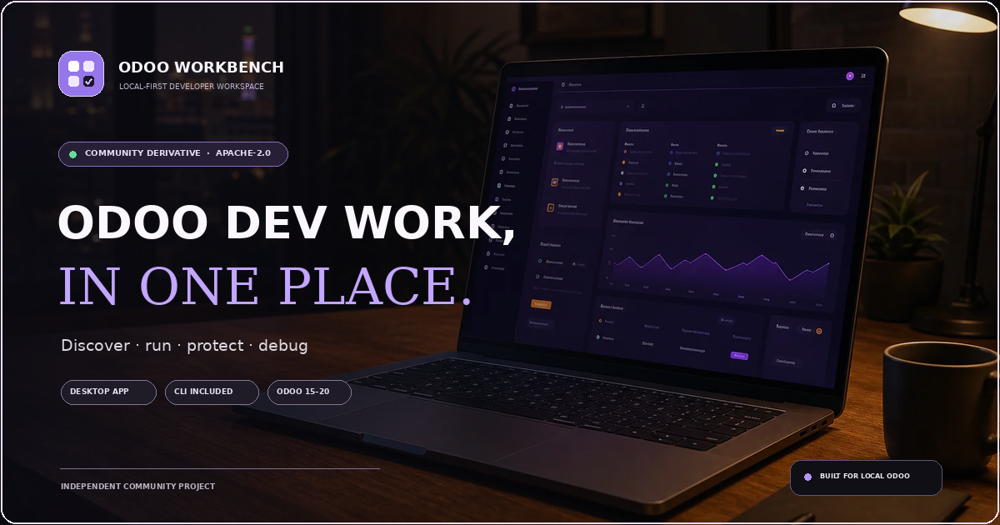
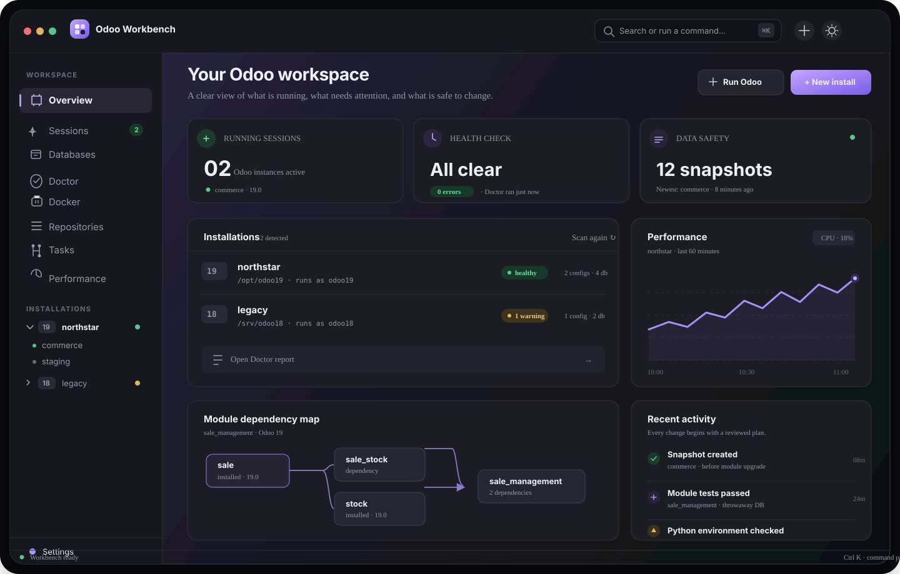
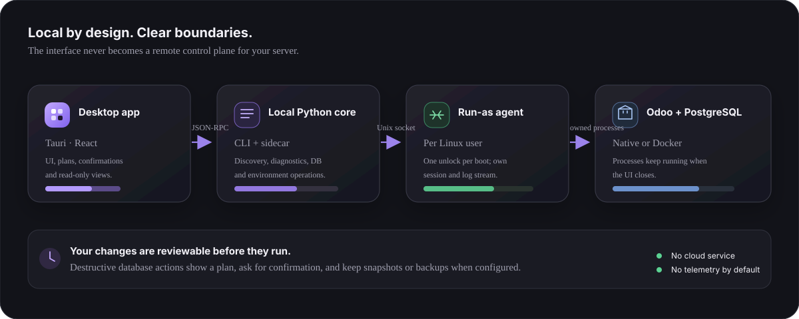

<!-- Modified for the Odoo Workbench derivative, 2026. Based on the Apache-2.0 project cited below. -->

<div align="center">
  
  <h1>Odoo Workbench</h1>
  <p><strong>Your local Odoo development environment, under one roof.</strong></p>
  <p>Discover installations. Run instances. Keep databases safe. Get back to building.</p>
</div>

<p align="center">
  
</p>

<p align="center"><em>Original product artwork for Odoo Workbench. The interface image below is an illustrative concept, not a captured app screenshot.</em></p>

<p align="center">
  
</p>

> **A local-first control room for Odoo developers.** Odoo Workbench brings installations, processes, databases, modules, Docker stacks, Git repositories, Python environments, tasks, debugging and performance into one desktop app—with the same tools available from the `odp` CLI.

## What it does

| Area | Workbench capabilities |
| --- | --- |
| **Discover & diagnose** | Finds Odoo source trees, virtual environments, config files, databases, filestores, processes and systemd units without changing anything. Doctor flags broken environments, unsafe config permissions, port collisions, failed units and missing filestores; it can safely repair a broken venv. |
| **Run & observe** | Start an instance as its own Linux user with a database, modules to install/upgrade, `--dev` flags or an interactive shell. Follow sessions and logs, stop a process deliberately, and keep Odoo running when the app closes. |
| **Database safety** | Back up, restore, clone with filestore, neutralize and drop databases. Preview a plan before data-changing actions; create a snapshot by hand or before a module upgrade; revert while preserving the replaced database under a new name. |
| **Modules & upgrades** | Explore addon dependencies as a graph, check installed state/version against manifests, find missing/shadowed/cyclic modules, inspect uncommitted work, scaffold a module, and run tests in a throwaway database. Manifests are read—not imported. |
| **Docker** | Create an Odoo + PostgreSQL stack in one flow, then manage recognized Odoo containers alongside native installs: logs, restarts, upgrades, backups, snapshots, restores, database cloning and container-aware diagnostics. |
| **Provisioning** | Provision Odoo 15–20 with a pinned Python, venv, PostgreSQL role and first config—from scratch or from a shareable profile. Review privileged steps before they run. |
| **Git workspace** | See branches, worktrees, changes and sync state across repositories. Fetch, fast-forward pull, switch or clone after reviewing a plan. No reset, clean, force-push or push actions. |
| **Python environments** | Compare venv requirements with Odoo and repository requirement files, surface conflicts, install as the run-as user, validate imports and manage development tools. |
| **Tasks & debugging** | Save multi-step workflows with previews, confirmations, retry-from-failure and history. Start Odoo under debugpy, attach VS Code, and jump from traceback lines to source files. |
| **Performance & inspection** | Inspect Odoo CPU/memory, PostgreSQL sessions, blocking locks, long queries and connection usage; explore models, fields, relations, external IDs and table sizes read-only. |

Every high-impact change is designed to be understandable before it runs. The app and CLI use the same Python core.

## Local by design

<p align="center">
  
</p>

The desktop app communicates with a local Python sidecar. A small agent runs as each Odoo version user over a Unix socket; a one-time unlock per boot lets it manage Odoo without repeated password prompts. Odoo processes survive closing the UI. See [the security model](SECURITY.md) before running on a shared workstation.

## Install & run

This repository is a new community derivative; **it does not reuse the upstream APT signing key or claim an independent release/update channel yet.** When a Workbench release is published, download its `.deb` from this repository's Releases page and install it with:

```bash
sudo apt install ./odoo-workbench_<version>_amd64.deb
```

The package build targets Ubuntu 24.04 and 26.04 on x86_64. Until the first Workbench release is available, use the source tree to develop and test:

1. Install Node.js 22, pnpm 9, Rust/Cargo, Python 3.12, `uv`, and the native Tauri/WebKit build dependencies listed in [CI](.github/workflows/ci.yml).
2. Review and run the local development host setup if you want to test the privileged agent flow: `sudo spike/setup-dev-host.sh`.
3. From the repository root, run `./dev.sh`. The desktop app opens with hot reload; `./dev.sh test` runs the Python-core unit tests.

The CLI command remains `odp`, and a few runtime/config paths retain their upstream names for compatibility with the inherited implementation. The user-facing product and the new repository are named **Odoo Workbench**.

## Design principles

- **Preview first.** Show commands and the plan before changes; confirm destructive database operations.
- **Local first.** No hosted control plane is needed; discovery and management stay on the workstation.
- **Least privilege.** Odoo runs as its own Linux user through a constrained agent.
- **Back up before risk.** Snapshots can be created before upgrades and reverted without deleting the replaced database.
- **Respect the source.** Workbench retains the Apache-2.0 license and attributes the project this derivative is based on.

## Free setup consultation

Trying Workbench on a real Odoo workstation? We’re offering a **free, no-pressure setup consultation** for early adopters. In the repository, open **Issues → New issue → Free consultation** and share your Odoo version, Ubuntu version and the workflow you want help with—never post secrets, database dumps or config files. A maintainer can follow up with next steps.

## Project status

The application and Python core in this repository are derived from an actively developed upstream project and retain its broad existing feature set. The independent Workbench manifests start at **0.1.0 (unreleased)**. Its own release artifacts, signing key, update channel and contact workflow still need to be set up by its maintainers before a production launch. No affiliation with or endorsement by Odoo S.A. is implied.

## Documentation

- [Install and first run](docs/install.md)
- [Troubleshooting](docs/troubleshooting.md)
- [Security model](SECURITY.md)
- [Contributing](CONTRIBUTING.md)
- [Launch copy](marketing/launch-post.md)
- [Publish to GitHub](PUSH_TO_GITHUB.md)

## Attribution, trademark & license

Odoo Workbench is a community-maintained derivative of **[Odoo Dev Panel](https://github.com/SparkDrago05/odoo-dev-panel)** by SparkDrago05. The inherited application/core are distributed under the included [Apache License 2.0](LICENSE); this repository preserves that license and provides derivative-work attribution in [`NOTICE`](NOTICE). The Workbench name, refreshed documentation and original marketing artwork are additions to that codebase.

Odoo is a trademark of Odoo S.A. This independent project is not affiliated with, sponsored by or endorsed by Odoo S.A. Product compatibility references are descriptive only.
